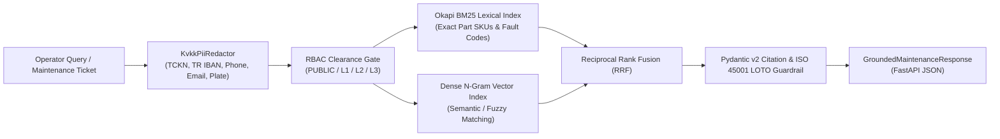

# Enterprise Industrial Hybrid RAG & Maintenance Copilot

[](https://github.com/tncyavci/enterprise-industrial-rag-maintenance-copilot/actions/workflows/ci.yml)

**KVKK/GDPR PII-Redacting Hybrid RAG (Okapi BM25 + Character N-Gram Dense Reciprocal Rank Fusion), SQLite Compliance Audit Trail, Vision/Sensor Defect Triage, FastMCP Tool Server, and ISO 45001 Lockout/Tagout (LOTO) Citation Guardrails built with Python, FastAPI, Streamlit, and Pydantic v2.**

Designed for enterprise manufacturing, automotive R&D, aviation MRO, and regulated banking/corporate IT environments where Standard Operating Procedures (SOPs), maintenance manuals, and incident tickets cannot be sent to external LLMs without strict **Turkish KVKK / GDPR PII sanitization**, **document-level RBAC clearance enforcement**, and **zero-hallucination verbatim citation proofs**.

---

## System Architecture



---

## Core Enterprise Capabilities

### 1. Deterministic KVKK / GDPR PII Sanitization (`KvkkPiiRedactor`)
Before any maintenance ticket or operator transcript touches the retrieval index or prompt pipeline, sensitive identifiers are deterministically masked and logged as structured `PiiRedactionEvent` audit records:
- **Turkish National ID (`TCKN`):** 11-digit pattern + official algorithmic modulo-10 checksum validator (`is_valid_tckn_checksum`).
- **Turkish IBAN (`TR_IBAN`):** Full 26-character `TRxx...` bank account redaction.
- **Turkish Mobile Phone (`TR_PHONE`), Email (`EMAIL`), and Vehicle License Plates (`TR_PLATE`).**

### 2. Hybrid RRF Retrieval (`HybridRrfRetriever`)
Pure vector search frequently fails on industrial part numbers (`SKU-HD-8841`, `MSD-PLUG-900`) and diagnostic trouble codes (`SRVO-053`, `P0AA6`). This engine combines:
- **Okapi BM25 ($k_1=1.5, b=0.75$):** Exact lexical matching on part numbers, error codes, and equipment categories.
- **Character Trigram Cosine Similarity:** Resilient against typos and morphological variations.
- **Reciprocal Rank Fusion (RRF, $k=60$):** Merges both rankings deterministically without brittle score-calibration weights.

### 3. Document-Level RBAC & ISO 45001 Lockout/Tagout (LOTO) Guardrails (`GroundedMaintenanceResponse`)
- **Clearance Filtering:** High-voltage EV battery (`RESTRICTED_SAFETY_L3`) or robotics servo procedures (`MAINTENANCE_ENGINEER_L2`) are automatically filtered out if queried by an unauthorized clearance tier (`OPERATOR_L1`).
- **Zero-Hallucination Citation Validator:** Pydantic v2 `@model_validator` rejects any non-abstained response that lacks a verbatim `CitationEvidence` quote from an authorized `SOP-*` document.
- **ISO 45001 Safety Interlock:** Any procedure classified as `IMMEDIATE_LINE_STOP` is mathematically forced to set `lockout_tagout_mandatory=True`.

### 4. Persistent SQLite Knowledge & Immutable KVKK/RBAC Audit Trail (`SqliteEnterpriseKnowledgeStore`)
- Persists all Standard Operating Procedure (`SOP-*`) chunks and records every operator query into an immutable `compliance_audit_log` table with UTC timestamps, caller clearance tier, PII redaction counts, LOTO enforcement flags, and cited document IDs.
- Exposed via `GET /api/v1/copilot/audit-logs` and `POST /api/v1/copilot/sop` for enterprise compliance officers.

### 5. Vision OCR Nameplate & Sensor Telemetry Defect Triager (`VisionTelemetryDefectTriager`)
- Combines noisy industrial camera OCR nameplate text (`SKU-HD-8841`, `MSD-PLUG-900`) with physical sensor telemetry thresholds (**ISO 10816** servo vibration `>= 7.1 mm/s`, **ECE R100** HV battery isolation `< 100 Ohm/V`, and paint-booth differential pressure `> 240 Pa`) via `POST /api/v1/copilot/triage-telemetry`.

### 6. Model Context Protocol (`FastMCP`) Server & Interactive Streamlit Console
- **`mcp_server.py`:** Exposes `query_industrial_maintenance_sop`, `triage_station_telemetry_and_ocr`, and `get_kvkk_compliance_audit_trail` as standardized MCP tools for autonomous AI agents.
- **`app.py` & `Dockerfile`:** Interactive 3-tab Streamlit operator/auditor console and containerized multi-service deployment.

---

## Quick Start & Testing

```bash
python3 -m venv .venv
source .venv/bin/activate
pip install -e ".[dev]"

# Run unit & API integration tests
pytest -v

# Start FastAPI REST server
uvicorn industrial_rag_copilot.api:app --reload --port 8090

# Launch interactive Streamlit Engineering & Audit Console
streamlit run app.py

# Run FastMCP Server for LLM Agent Tool Calling
python mcp_server.py
```

---

## Repository Structure

```text
├── pyproject.toml
├── Dockerfile                # Production container image (Python 3.11-slim + FastAPI)
├── app.py                    # Interactive 3-tab Streamlit Operator, Telemetry & Audit Console
├── mcp_server.py             # FastMCP tool server for LLM agent integration
├── docs/adr/
│   └── ADR-001-hybrid-rrf-and-kvkk-guardrails.md
├── src/industrial_rag_copilot/
│   ├── models.py             # Pydantic v2 schemas, RBAC enums, LOTO & citation guardrails
│   ├── pii_redactor.py       # KVKK/GDPR PII redactor & algorithmic TCKN checksum validator
│   ├── retriever.py          # Okapi BM25 + Dense Trigram Reciprocal Rank Fusion (RRF)
│   ├── persistent_store.py   # SQLite SOP repository & immutable KVKK/RBAC audit log store
│   ├── vision_defect_triage.py # Camera OCR nameplate + ISO 10816 / HV sensor anomaly triager
│   ├── service.py            # Orchestration service & abstention handling
│   ├── api.py                # FastAPI REST endpoints (/health, /query, /triage-telemetry, /sop, /audit-logs)
│   └── cli.py                # CLI runner for terminal diagnostics
└── tests/
    └── test_industrial_copilot.py
```

---

## License
MIT License. See [LICENSE](LICENSE).
